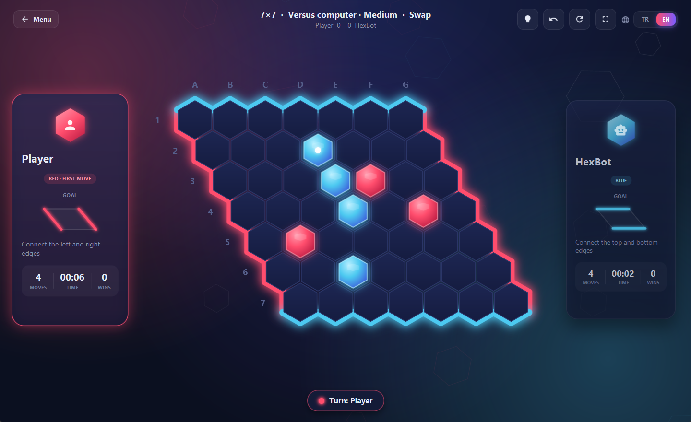

<div align="center">

# ⬢ HEX

**Connect your edges. Cut your rival off.**

A Hex strategy game built with JavaFX, featuring a neon interface, a computer opponent and a bilingual UI.

[](https://github.com/AykanYilmz/HexGame/actions/workflows/ci.yml)




[Download](#-install) · [How to play](#-how-to-play) · [Features](#-features) · [HexBot](#-how-hexbot-thinks) · [Development](#-development) · [🇹🇷 Türkçe](README.md)

</div>

---

## 🎯 How to play

Hex is a two-player connection game invented independently by Piet Hein in 1942 and John Nash in 1948. You can learn the rules in a minute and spend years mastering it.

- Players take turns placing a stone on any empty hexagon. **Red goes first.**
- 🔴 **Red** tries to link the left and right edges with an unbroken chain, 🔵 **blue** the top and bottom edges.
- Every hexagon has six neighbours, and chains run through them.
- **There are no draws:** someone always wins before the board fills up.

> 💡 **Bridge:** two stones that share two empty neighbours cannot be cut. If your rival takes one, you take the other. It is the strongest tactic in the game.

### Swap rule (pie rule)

Moving first is a big advantage. With the swap rule on, blue may **take over** red's first stone on its first move, so red has to open with a move modest enough that blue won't want it.

The stone is **mirrored** across the board's long diagonal as it changes hands: red's stone on `C4` becomes blue's stone on `D3`. Since red plays left to right and blue top to bottom, the mirrored stone is worth exactly as much to blue as the opening was to red. This is the standard way to apply the swap when each player keeps their colour.

## ✨ Features

- **Two players** on one computer, or **versus HexBot** on Easy, Medium or Hard.
- **Six board sizes:** 5×5, 7×7, 9×9, 11×11, 13×13 and 17×17.
- **Swap rule** that HexBot uses on its own. Easy often gets the decision wrong, Hard never does.
- **Hints** that know the swap rule and suggest taking over a strong opening.
- **Undo**, even after the game has ended, so you can take back a losing move and try another line.
- **Rematch** with colours swapped; the score follows the players.
- Neon theme, animated stones, a glowing winning chain, and a board that scales to any window or full screen.
- **Turkish and English:** the 🌐 **TR | EN** switch in the top-right corner changes the language instantly, even mid-game. The system language is used on first launch.

| Key | Action |
| --- | --- |
| `F11` | Toggle full screen (`Esc` to leave) |
| `Ctrl + Z` | Undo |
| `H` | Show a hint |
| `R` | Restart the game |
| `Enter` | Start a game from the menu |

## 📦 Install

**Ready-made build (Windows, no Java needed):** download the latest `Hex-<version>-windows.zip` from [Releases](https://github.com/AykanYilmz/HexGame/releases), unzip it and run `Hex.exe`. The package ships its own Java runtime.

**From source:** you only need **JDK 21**, for example [Eclipse Temurin](https://adoptium.net/). Maven comes with the project as a wrapper.

```bash
git clone https://github.com/AykanYilmz/HexGame.git
cd HexGame

./mvnw javafx:run        # macOS / Linux / Git Bash
mvnw.cmd javafx:run      # Windows (cmd / PowerShell)
```

## 🤖 How HexBot thinks

HexBot scores positions with two metrics:

- **Shortest distance (0-1 BFS):** how many more empty cells a player needs to link its edges. Own stones cost 0, empty cells 1, and enemy stones are walls.
- **Two-distance:** a cell is only as close to an edge as its *second best* neighbour, because the opponent will always cut the best one. Single-file routes therefore count as weak, and double routes such as bridges as strong. Own groups are transparent: a cell next to a group neighbours every empty cell around it. This is the classic evaluation used by Hex programs such as Queenbee.

| Level | Evaluation | Search |
| --- | --- | --- |
| Easy | Shortest distance | Noisy one-ply, with the occasional sloppy move |
| Medium | Two-distance | Every move, one ply deep |
| Hard | Two-distance | Two-ply minimax over the best candidates |

Every level plays a winning move at once and blocks one-move threats. The search runs on a background thread, so the UI never freezes. On a 17×17 board, Hard's slowest move takes about 0.2 seconds.

## 🛠 Development

```bash
./mvnw test              # 44 unit tests
./mvnw javafx:jlink      # target/hexgame: image with an embedded Java runtime
```

GitHub Actions runs the tests on every push and pull request. Pushing a tag such as `v1.2.0` builds the Windows package and attaches it to a release.

**Adding a language:** copy `src/main/resources/io/github/aykanyilmz/hexgame/ui/messages_en.properties` to `messages_<code>.properties` and translate it, keeping placeholders such as `{0}`. Then add a constant such as `DE("de")` to [`Language.java`](src/main/java/io/github/aykanyilmz/hexgame/model/Language.java). The language switch picks it up automatically, and `I18nTest` fails if any key or placeholder is missing.

---

<div align="center">
Arif Aykan Yılmaz
</div>
