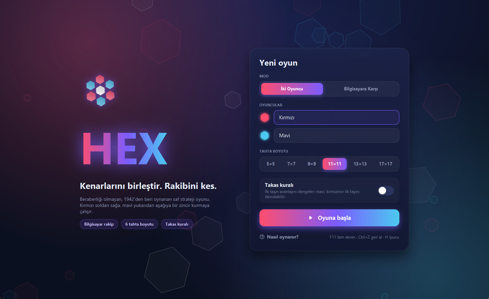
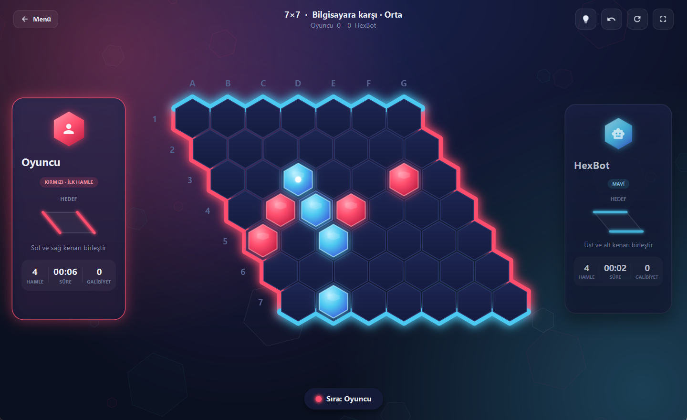
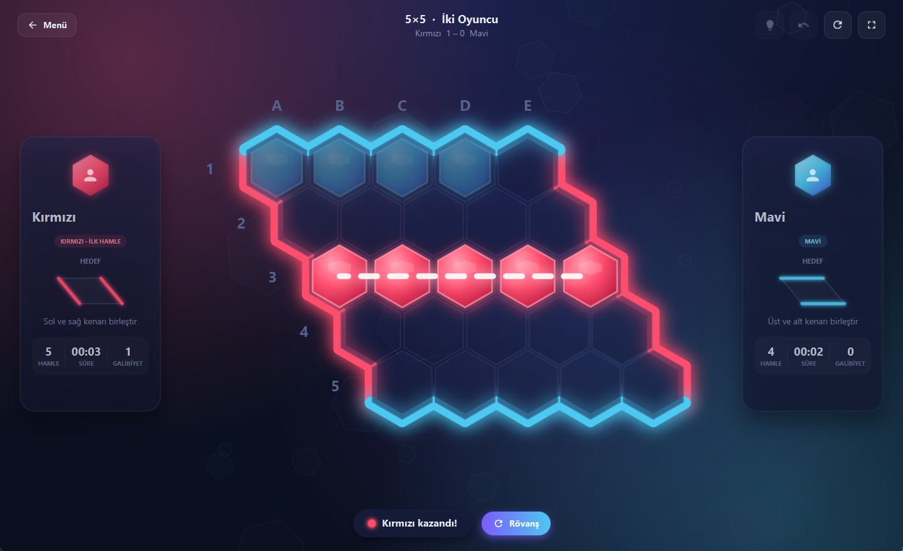
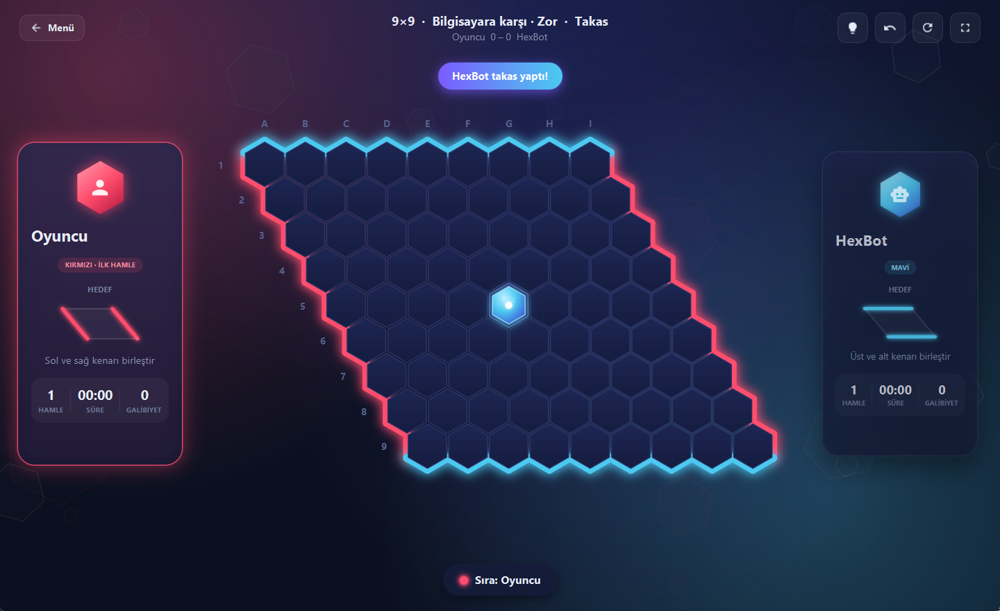
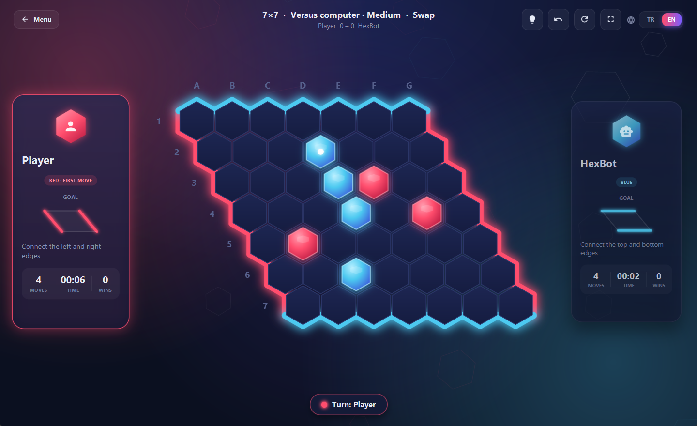

<div align="center">

# ⬢ HEX

**Kenarlarını birleştir. Rakibini kes.**

JavaFX ile yazılmış, neon arayüzlü, yapay zekâ rakipli ve iki dilli bir Hex strateji oyunu.

[](https://github.com/AykanYilmz/HexGame/actions/workflows/ci.yml)




<a href="https://github.com/AykanYilmz/HexGame/releases/latest/download/Hex-windows.zip"></a>

[Kurulum](#-kurulum) · [Nasıl oynanır](#-nasıl-oynanır) · [Özellikler](#-özellikler) · [HexBot](#-hexbot-nasıl-düşünüyor) · [Geliştirme](#-geliştirme) · [🇬🇧 English](README.en.md)

</div>

---

## 🎯 Nasıl oynanır?

Hex, 1942'de Piet Hein'ın, 1948'de de John Nash'in birbirinden habersiz icat ettiği iki kişilik bir bağlantı oyunudur. Kuralları bir dakikada öğrenilir, ustalaşmak ise yıllar sürer.

- Oyuncular sırayla boş bir altıgene taş koyar. **Kırmızı başlar.**
- 🔴 **Kırmızı** sol ve sağ kenarı, 🔵 **mavi** üst ve alt kenarı birleştiren kesintisiz bir zincir kurmaya çalışır.
- Her altıgenin altı komşusu vardır ve zincir bu komşuluklar üzerinden ilerler.
- **Beraberlik yoktur:** Tahta dolmadan biri mutlaka kazanır.

> 💡 **Köprü:** Aralarında iki ortak boş komşu bulunan iki taş kesilemez. Rakip birine girerse diğerini doldurursun. Oyunun en güçlü taktiğidir.

### Takas kuralı (pie rule)

İlk hamle büyük bir avantajdır. Takas kuralı açıksa mavi, ilk hamlesinde kırmızının taşını **devralabilir**. Böylece kırmızı, rakibin almak istemeyeceği kadar ölçülü bir açılış aramak zorunda kalır.

Devralınan taş, tahtanın uzun köşegenine göre **yansıtılarak** maviye geçer: kırmızının `C4`'teki taşı mavinin `D3`'teki taşı olur. Kırmızı soldan sağa, mavi yukarıdan aşağıya oynadığı için yansıtılan taş, mavi için tam olarak kırmızının açılışı kadar değerlidir. Bu, renklerin oyunculara sabit kaldığı Hex uygulamalarında kullanılan standart takas biçimidir.

## 📸 Ekran görüntüleri

| HexBot'a karşı | Kazanan zincir |
| :---: | :---: |
|  |  |
| **Takas kuralı:** HexBot güçlü açılışı devralıyor | **İngilizce arayüz:** dil oyun sırasında değişir |
|  |  |

## ✨ Özellikler

### Oynanış
- **İki oyuncu** aynı bilgisayarda ya da **HexBot'a karşı**. Kolay, Orta ve Zor seviyeleri var.
- **6 tahta boyutu:** 5×5, 7×7, 9×9, 11×11, 13×13, 17×17.
- **Takas kuralı:** HexBot ne zaman takas yapacağına kendisi karar verir. Kolay seviye bu kararda sık yanılır, Zor hiç yanılmaz.
- **İpucu:** HexBot'un önerdiği hücre altın bir halkayla gösterilir. Takas kuralını bilir: devralmaya değer bir açılışta takas önerir.
- **Geri alma:** Oyun bittikten sonra bile çalışır. Kaybettiğin hamleyi geri alıp başka bir yol deneyebilirsin.
- **Rövanş:** Renkler yer değiştirir, skor oyuncuyla birlikte taşınır.
- **Oyuncu kartları:** Her oyuncu için hamle sayısı, süre ve galibiyet.

### Arayüz
- Koyu neon tema, cam efektli kartlar ve süzülen altıgenlerden oluşan arka plan.
- Tahta açılışta dalga halinde belirir. Taşlar "pop" efektiyle yerleşir ve komşu hücreleri hafifçe titretir.
- Fare hangi hücrenin üzerindeyse orada sıradaki rengin önizlemesi görünür. Son hamle işaretlenir.
- Kazanınca zincir taş taş parlar, üzerinden ışık akar ve bulanık arka planlı bir sonuç kartı açılır.
- Tahta her pencere boyutuna ve tam ekrana ölçeklenir. Kenarlarda koordinatlar (A1, B2…) gösterilir.
- **Türkçe ve İngilizce:** Sağ üstteki 🌐 **TR | EN** düğmesiyle dil, oyun sırasında bile anında değişir. İlk açılışta sistem dili seçilir.
- Son kullanılan isimler, ayarlar ve dil bir sonraki açılışta hatırlanır.

### Kısayollar

| Tuş | İşlev |
| --- | --- |
| `F11` | Tam ekran aç/kapat (`Esc` ile çık) |
| `Ctrl + Z` | Geri al |
| `H` | İpucu göster |
| `R` | Oyunu yeniden başlat |
| `Enter` | Menüde oyunu başlat |

## 📦 Kurulum

### Hazır sürüm (Windows, Java gerekmez)

**[⬇ Hex-windows.zip dosyasını indir](https://github.com/AykanYilmz/HexGame/releases/latest/download/Hex-windows.zip)**, bir klasöre aç ve `Hex.exe`'ye çift tıkla. Paketin içinde kendi Java çalışma ortamı vardır. Eski sürümler [Releases](https://github.com/AykanYilmz/HexGame/releases) sayfasında.

> Windows SmartScreen "tanınmayan uygulama" uyarısı gösterirse *Ek bilgi → Yine de çalıştır* seçeneğine bas. Uygulama imzalı olmadığı için bu uyarı normal.

### Kaynaktan

Gereken tek şey **JDK 21**, örneğin [Eclipse Temurin](https://adoptium.net/). Maven kurmana gerek yok, proje wrapper ile gelir.

```bash
git clone https://github.com/AykanYilmz/HexGame.git
cd HexGame

./mvnw javafx:run        # macOS / Linux / Git Bash
mvnw.cmd javafx:run      # Windows (cmd / PowerShell)
```

> **Hibrit grafikli dizüstüler (Intel + NVIDIA/AMD):** Windows `java.exe`'yi varsayılan olarak entegre GPU'da çalıştırabilir. Tam ekranda akıcılık için *Ayarlar → Sistem → Ekran → Grafik* bölümünden `java.exe` (ya da `Hex.exe`) için **Yüksek performans** seç.

## 🤖 HexBot nasıl düşünüyor?

HexBot pozisyonları iki ölçüyle değerlendirir:

- **En kısa mesafe (0-1 BFS):** Kenarları birleştirmek için en az kaç boş hücre daha gerektiği. Kendi taşın 0, boş hücre 1 sayılır, rakip taşı geçilemez.
- **Two-distance:** Bir hücre kenara ancak *en iyi ikinci* komşusu kadar yakındır, çünkü rakip en iyi yolu her zaman keser. Böylece tek şeritlik yollar zayıf, köprü gibi çift seçenekli bağlantılar güçlü sayılır. Kendi taş grupları geçirgendir: bir grubun yanındaki hücre, grubun çevresindeki tüm boş hücrelere komşu kabul edilir. Queenbee gibi klasik Hex programlarının temel ölçüsüdür.

Puan, rakibin değeri ile kendi değerinin farkıdır. Eşitlikte bitirme yolu çeşitliliğine ve merkeze yakınlığa bakılır.

| Seviye | Değerlendirme | Arama |
| --- | --- | --- |
| Kolay | En kısa mesafe | Gürültülü tek hamle, ara sıra özensiz hamle |
| Orta | Two-distance | Tüm hamleler, tek hamle derinliğinde |
| Zor | Two-distance | En iyi adaylar için rakibin her cevabını deneyen 2 hamlelik minimax |

Her seviye kazandıran hamleyi hemen oynar ve rakibin bir hamlelik kazanma tehditlerini kapatır. Hesaplama arka plan iş parçacığında yapıldığı için arayüz donmaz. 17×17 tahtada Zor seviyenin en uzun hamlesi yaklaşık 0,2 saniye sürer.

Ölçümler: Orta seviye, eski en kısa mesafe tabanlı Zor seviyeyi 11×11'de 20 maçın 20'sinde yendi. Zor seviye ise Orta'yı 9×9'da 30 maçın 27'sinde yeniyor.

## 🛠 Geliştirme

```bash
./mvnw test              # 44 birim testi
./mvnw javafx:run        # oyunu başlat
./mvnw javafx:jlink      # target/hexgame: Java çalışma ortamı gömülü imaj (+ hexgame.zip)
```

Windows'ta çift tıklanabilir `Hex.exe` üretmek için:

```bash
jpackage --type app-image --name Hex --runtime-image target/hexgame \
  --module io.github.aykanyilmz.hexgame/io.github.aykanyilmz.hexgame.HexApp --dest target/dist
```

**CI / sürüm:** Her push ve pull request'te GitHub Actions testleri çalıştırır. `v1.2.0` gibi bir etiket push'landığında Windows paketi otomatik üretilip Releases sayfasına eklenir.

### Proje yapısı

```
src/main/java/io/github/aykanyilmz/hexgame/
├── HexApp.java              Uygulama girişi ve ekran geçişleri
├── model/                   Oyun mantığı (arayüzden bağımsız)
│   ├── Board.java           Tahta, hamle geçmişi, takas, geri alma, kazanan yol (BFS)
│   ├── GameConfig.java      Maç ayarları
│   ├── Player · Difficulty · Language
│   └── Settings.java        Ayarların ve dilin java.util.prefs ile saklanması
├── ai/
│   └── HexAI.java           HexBot
└── ui/
    ├── MenuView.java        Ana menü ve kurallar penceresi
    ├── GameView.java        Oyun akışı, araç çubuğu, sonuç kartı
    ├── BoardView.java       Altıgen tahta ve taş animasyonları
    ├── PlayerCard.java      Oyuncu kartları
    ├── I18n.java            Arayüz metinleri ve canlı dil değişimi
    ├── LanguageSwitch.java  TR | EN düğmesi
    ├── Segmented · ToggleSwitch · Modal · AnimatedBackground
    └── Theme · Fx · Icons   Renkler, animasyon yardımcıları, vektör ikonlar
src/main/resources/io/github/aykanyilmz/hexgame/
├── styles.css
└── ui/messages_tr.properties · messages_en.properties
src/test/java/…              Tahta, HexBot, ayarlar ve çeviri testleri
```

### Yeni bir dil eklemek

1. `ui/messages_en.properties` dosyasını `messages_<kod>.properties` adıyla kopyalayıp çevir. `{0}` gibi yer tutucuları koru.
2. [`Language.java`](src/main/java/io/github/aykanyilmz/hexgame/model/Language.java)'ya yeni bir sabit ekle, örneğin `DE("de")`.

Dil düğmesi yeni dili kendiliğinden gösterir. `I18nTest`, bütün dillerde aynı anahtarların ve yer tutucuların bulunduğunu denetler; çevrilmemiş bir metin kalırsa test başarısız olur.

### Performans notları
- Taşların, tahta kenarlarının ve başlıkların parlama efektleri bir kez çizilip önbellekten kullanılır.
- Oyun sırasında arka plan animasyonu durur. Sonuç kartının arkasındaki bulanık ekran bir kez hesaplanır.
- Sürekli dönen animasyonlar yalnızca efekt içermeyen ya da önbelleğe alınmış öğelerde kullanılır.

---

<div align="center">
Arif Aykan Yılmaz
</div>
